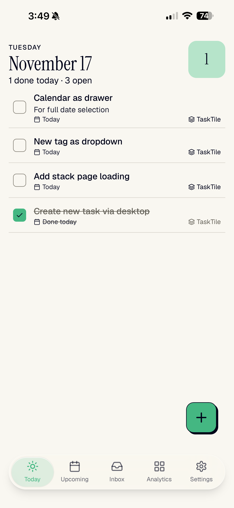
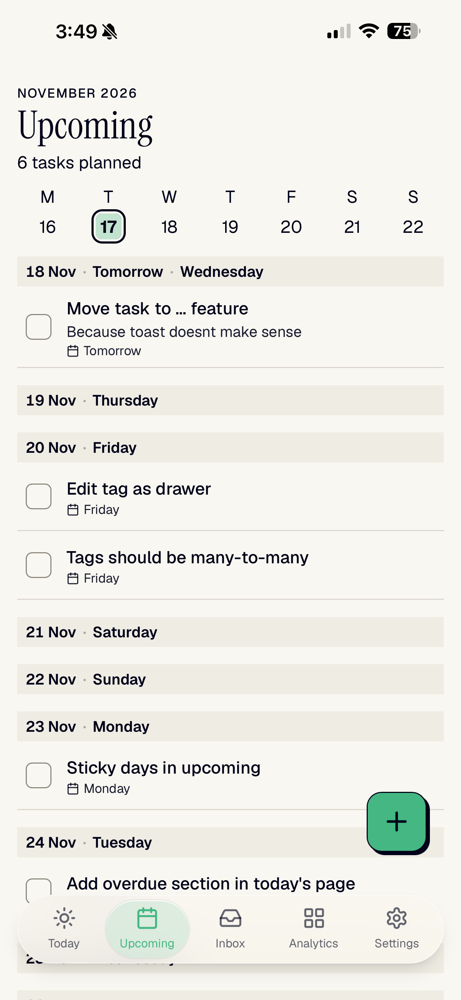
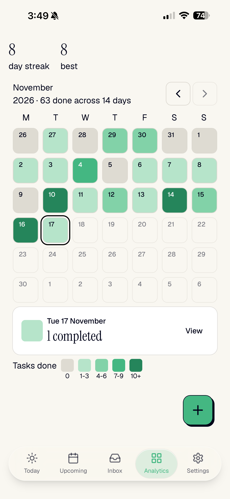

# TaskTile

A productivity-focused to-do app that helps you plan work and see your progress over time with a task-completion heatmap.

[Open TaskTile](https://tasktile.sanerasolutions.com)

## Features

- Capture tasks in your inbox, plan work for today, and review upcoming due dates.
- Organize tasks with custom tags and stacks.
- Track completed tasks in a calendar heatmap, with daily totals and monthly activity.
- Select a day to review the tasks completed then.
- See your current and best completion streaks.
- Create an account, manage app preferences, and use the responsive web app on mobile.
- Includes a web app manifest and platform icons for home-screen installation.

## Mobile-First Experience

TaskTile is a Progressive Web App (PWA) developed with a mobile-first approach. The interface and interactions are primarily designed around mobile usage, prioritizing touch-friendly interactions and an intuitive productivity experience.

The application can be installed on supported devices and accessed directly from the home screen, providing an app-like experience without requiring a traditional app store installation.

Mobile is the primary design and development target. Desktop layout refinements are still ongoing.

Screenshots

Here is a look at TaskTile's mobile experience.

<p align="center">      &nbsp;&nbsp;      &nbsp;&nbsp;    </p>

## Tech stack

- Next.js App Router and React
- TypeScript and Tailwind CSS
- Neon Auth for authentication
- PostgreSQL on Neon, accessed through Prisma
- TanStack Query for client-side data fetching and caching

## Prerequisites

- Node.js 22.17.0
- pnpm
- A PostgreSQL database and Neon Auth configuration

## Getting started

1. Clone the repository and enter the project directory:

   ```bash
   git clone https://github.com/rns-jey/tasktile.git
   cd tasktile
   ```

2. Create a `.env` file in the project root:

   ```env
   DATABASE_URL="your-postgres-connection-string"
   NEON_AUTH_BASE_URL="your-neon-auth-base-url"
   NEON_AUTH_COOKIE_SECRET="your-long-random-secret"
   ```

   Use your own development database and Neon Auth settings. Keep real credentials out of Git.

3. Install dependencies. The install script generates the Prisma client:

   ```bash
   pnpm install
   ```

4. For a new development database, sync the Prisma schema:

   ```bash
   pnpm exec prisma db push
   ```

5. Start the development server:

   ```bash
   pnpm dev
   ```

   Open [http://localhost:3000](http://localhost:3000).

## Available scripts

| Command                | Description                  |
| ---------------------- | ---------------------------- |
| `pnpm dev`             | Start the development server |
| `pnpm build`           | Create a production build    |
| `pnpm start`           | Run the production server    |
| `pnpm storybook`       | Start Storybook              |
| `pnpm build-storybook` | Build the Storybook site     |

## Database

The Prisma schema is in `prisma/schema.prisma`. Point `DATABASE_URL` at a development database before running Prisma commands. Avoid running schema changes against a production database unless you intend to update it.

## License

No license file is currently present in the repository.
